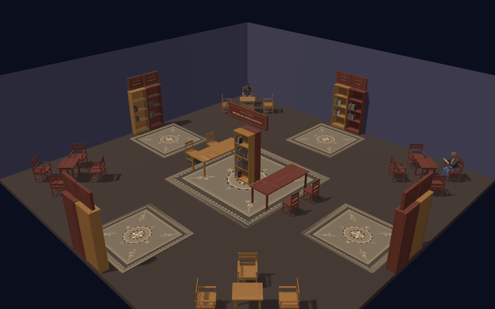
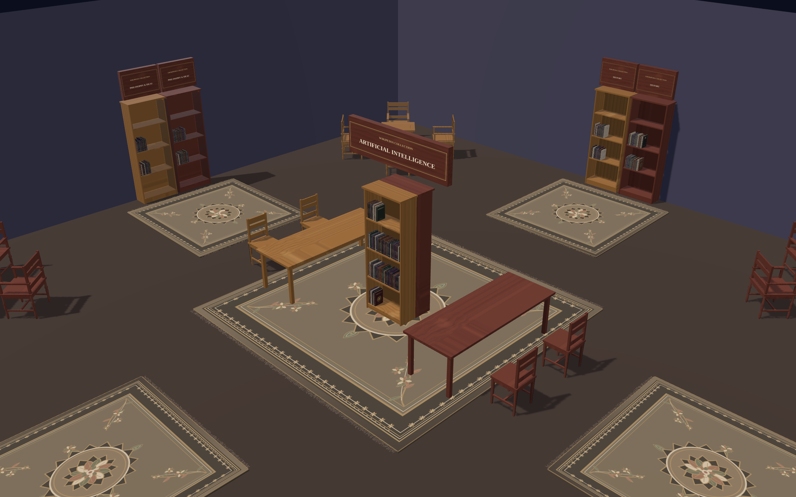

# Alexandrpedia

A reading room for encyclopedia articles. AI sits at the centre, with History, Science, American Popular Culture and Philosophy & Ideas on the four walls. Every article is a book from a committed Wikipedia or Grokipedia snapshot, shelved in its collection and laid out in the room with its reading furniture.



## The room

- **AI at the centre.** Two back-to-back bookcases hold the Wikipedia and Grokipedia collections, flanked by two long tables on which a book is read.
- **Four walls.** Each subject has a pair of bookcases, a plaque and a rug.
- **Corner nooks.** Each corner has a table and four armchairs, and readers sit there and come and go.



## Reading

Click a book to take it down and open it. Click a page's side to turn it, or use the arrow keys. Press Escape, or click the room, to put the book back.


## Readers

Tick **People** and readers come in through the glass doors, one at a time and whenever they please. Each is a random person, made only when they arrive (and kept for a later arrival once they have gone). They walk (round the shelves, tables and chairs) to a bookcase with empty hands, reach up and take a book, which leaves its shelf, and walk away with it, a Book of Madness, in hand. Then they either leave with it or sit down in one of the corner nooks and read it. When they have read, they either put it back and take another, put it back and leave, or leave with the book (it turns up on its shelf again a minute or two later). Switching People off puts every book back.

Making a person takes a moment, the first ever longest (the engine paints skin, clothes and hair, and shares what it can): a banner with a moving bar says so while it does.

## Controls

| Action | Control |
|---|---|
| Open a book | Click it |
| Turn a page | Click the side of the open page, or the arrow keys |
| Put a book back | Escape, or click the room |
| Orbit | Drag |
| Pan | Right-drag, Shift-drag, or two fingers; or W/A/S/D and the arrow keys when no book is open |
| Zoom | Scroll, or pinch |
| Reset the view | Double-click, or press R |

## Running it

The engine is an npm dependency (`madness-engine`, pinned to a commit in `package.json`), and Vite runs the site:

```bash
npm install
npm run dev
```

Then open the local address Vite prints (http://localhost:5173/ by default). `npm run build` writes the site to `dist/`, and `npm run preview` serves that build. Node 22.12 or later is required.

## Tests

```bash
npm test
```

The tests cover room layout, the rug, book shelving and snapshot pacing, and check the committed snapshots offline. `npm run check-titles` confirms that every curated title has a readable snapshot for both encyclopedias.

## Articles

The articles are committed snapshots in `data/wikipedia` and `data/grokipedia`. To refresh them:

```bash
npm run snapshot-all
npm run update-articles
```

## Layout

- `src/app.js`: the room, the views and the controls.
- `src/room-layout.js`: where the bookcases, tables, chairs and books stand.
- `src/room-plan.js`, `src/walk-paths.js`, `src/readers.js`: where readers sit, the routes they walk round the furniture, and what they do (a state machine that knows nothing of the scene).
- `src/page-block.js`: the block of paper in each shelved book. A shelved book is a cover and one box, not a mesh to every leaf, and its cover is drawn in full (painted at full size) only while you are near it; further off it is a plain box in the colour of its cloth.
- `src/catalog.js`, `src/sections.js`, `src/library.js`: the curated titles and their snapshots.
- `src/rug.js`: the Persian rugs.
- `madness-engine` (npm dependency, in `node_modules/`): the engine that draws the room and its props.
